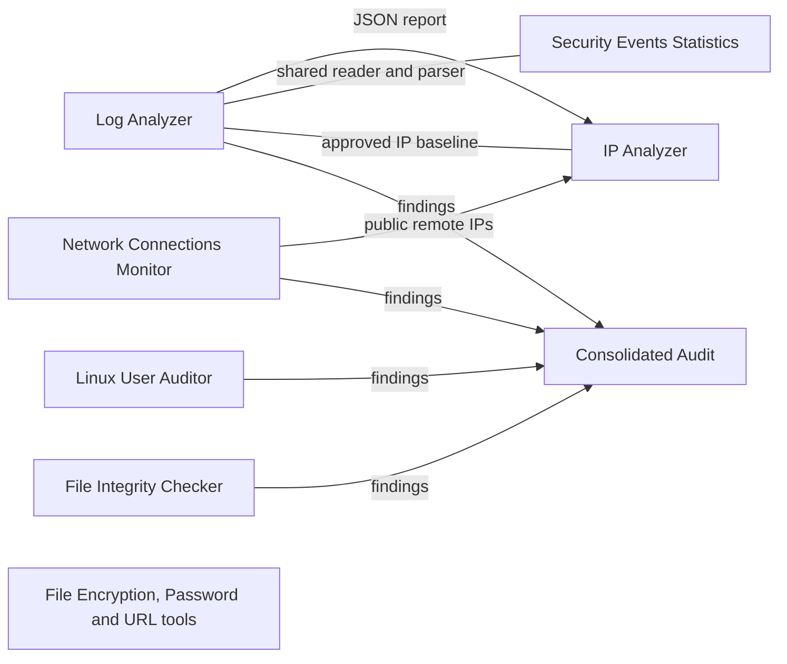

# Linux Security Toolkit

[](https://github.com/tomasnicolucci/linux-security-toolkit/actions/workflows/ci.yml)

[](LICENSE)

A set of ten independent security tools for Linux, plus a consolidated audit that runs several of them and produces one report. They help to analyze passwords and URLs, detect attacks in logs, investigate IP addresses, audit users and privileges, watch the network and protect files.

The tools are **read-only by default**, treat every input as untrusted, and run from a command line inside Docker. They work on their own and can be combined, for example to detect an attack in a log and then investigate the addresses behind it.

> This is a learning and portfolio project. A finding is an indicator, not proof of an attack, and the toolkit is not a replacement for a full monitoring solution.

## Modules

| # | Module | What it does | Command | Docs |
|---|---|---|---|---|
| 1 | Password Generator | Cryptographically secure random passwords | `password generate` | [guide](docs/password-generator.md) |
| 2 | Password Analyzer | Strength, weaknesses and estimated cracking time (zxcvbn) | `password analyze` | [guide](docs/password-analyzer.md) |
| 3 | URL Security Analyzer | Phishing indicators: deceptive domains, IP hosts, shorteners, homograph characters | `url analyze` | [guide](docs/url-security-analyzer.md) |
| 4 | File Integrity Checker | SHA-256 baselines and detection of modified, added and deleted files | `integrity` | [guide](docs/file-integrity-checker.md) |
| 5 | Log Analyzer | SSH brute force, password spraying, distributed attacks, privileged activity and more | `logs analyze` | [guide](docs/logs-analyzer.md) |
| 6 | IP Analyzer | Classification, reverse DNS and ownership (RDAP) of IPv4/IPv6 addresses | `ip analyze` | [guide](docs/ip-analyzer.md) |
| 7 | Security Events Statistics | Trends by hour or day and comparison between periods | `stats analyze` | [guide](docs/security-events-statistics.md) |
| 8 | Linux User Auditor | Accounts, sudo privileges, password policy, SSH settings and file permissions (Bash) | `user-auditor` service | [guide](docs/linux-user-auditor.md) |
| 9 | File Encryption | Authenticated encryption (AES-256-GCM) with Argon2id or key files | `encryption` | [guide](docs/file-encryption.md) |
| 10 | Network Connections Monitor | Listening ports, connections, owning processes, suspicious patterns and change detection | `network-monitor` service | [guide](docs/network-monitor.md) |

## Consolidated audit

`audit run` runs the user, network, file integrity and log checks and writes **one report** (Markdown and JSON): an overall status, what could and could not be checked, every finding with its recommended fix, and what is new or resolved compared with the previous audit. See the [guide](docs/audit-report.md).

## Quick start

You only need Docker and Docker Compose.

```bash
git clone https://github.com/tomasnicolucci/linux-security-toolkit.git
cd linux-security-toolkit
docker compose build
docker compose run --rm security-toolkit --help
```

Try a few modules with the included sample files:

```bash
# Generate a password and analyze a suspicious URL
docker compose run --rm security-toolkit password generate --length 20
docker compose run --rm security-toolkit url analyze "https://paypal.com.example.net/login"

# Detect attacks in a sample authentication log
docker compose run --rm security-toolkit logs --config /app/config.yaml analyze /app/samples/logs/auth.log --year 2026

# Classify an IP address and find out who owns it
docker compose run --rm security-toolkit ip analyze 8.8.8.8 --resolve --rdap

# Audit a deliberately insecure sample system
docker compose run --rm user-auditor --root /app/samples/system --no-permission-checks

# Show the listening ports and connections of the host
docker compose run --rm network-monitor scan

# Run a consolidated audit and get one report
docker compose run --rm audit run --root /app/samples/system --no-permission-checks
```

### What the output looks like

```text
[CRITICAL] UA-001 Account 'toor' has UID 0 (root privileges)
    Any account with UID 0 is equivalent to root. Only 'root' should have UID 0.
    Fix: Remove the account or give it a unique UID, and review how it was created.

[HIGH] NC-001 Redis is listening on all network interfaces (port 6379)
    Redis often runs without authentication, and it accepts connections from the network.
    Fix: Bind it to 127.0.0.1 or a private interface, restrict it with a firewall, and use an SSH tunnel or VPN for remote access.
```

Every finding has a severity, an explanation and a recommended fix. Reports can also be exported as JSON.

## Workflows

The modules complement each other. See [Example Workflows](docs/workflows.md) for complete scenarios:

- investigate an SSH attack: log analysis, then IP investigation, then period comparison
- review what a server exposes: port baseline, change detection and remote host investigation
- audit a new server and keep an eye on it with scheduled checks
- run a consolidated audit and compare it with the previous one
- protect a report before sharing it

## Architecture



- **Independent modules:** each tool has its own package under `src/`, and the business logic is separate from the command line so it can be reused later, for example from an API.
- **Shared pieces are explicit:** the Statistics module reuses the log reader and parser, and the IP Analyzer reuses the approved IP baseline, so related modules always agree.
- **The User Auditor is a Bash script** so that it can run directly on a server without Python or Docker. The toolkit runs it through `users audit` and through the consolidated audit.
- **The consolidated audit reuses the modules** through small adapters that convert each result to one common format.

## Security design

- **Read-only audits.** The analyzers never change the system they inspect; they only write the reports and baselines you ask for. The encryption module never overwrites a file without `--force` and never deletes the original.
- **Untrusted input.** Log lines, `/proc` data, DNS answers, RDAP responses and file headers are validated, size-limited and cleaned of terminal control characters before they are shown.
- **Sensitive data.** Password hashes are hidden unless `--show-hashes` is used, and consolidated reports never include them. Passwords are never accepted as command line arguments. Private outputs are created with mode 600.
- **No false all-clear.** The consolidated report states which checks could not run, so a missing check is never shown as a clean result.
- **No surprise network access.** Only the IP Analyzer contacts external services, and only when `--resolve` or `--rdap` is requested.
- **Tested.** More than 270 automated tests cover all modules, and they run on every push.

## Project structure

```text
src/
├── cli.py            command line entry point
├── password/         modules 1 and 2
├── url/              module 3
├── integrity/        module 4
├── logs/             module 5
├── ip/               module 6
├── statistics/       module 7
├── users/            module 8 (Bash script)
├── encryption/       module 9
├── network/          module 10
└── audit/            consolidated audit
tests/                automated tests
samples/              sample logs and a deliberately insecure sample system
docs/                 one guide per module, plus example workflows
```

## Development

Run the tests with Docker, without installing anything else:

```bash
docker compose run --rm tests
docker compose run --rm tests -k network
```

Or locally with Python 3.13 on Linux, macOS or WSL:

```bash
pip install -r requirements-dev.txt
pytest
ruff check .
```

Every push and pull request runs the linter, the tests and the Docker build with GitHub Actions (see `.github/workflows/ci.yml`).

## Limitations

- Linux only: the network monitor reads `/proc`, and the User Auditor audits Linux account files.
- The File Encryption module uses its own file format and has not been audited. For production secrets, use an audited tool such as `age` or GPG.
- The Docker services that inspect the host (`user-auditor`, `network-monitor`, `audit`) need extra privileges. On Docker Desktop, "the host" is the Docker virtual machine, not your computer.

## Roadmap

- More log sources (web servers, journald) and more detection rules
- A REST API and a web dashboard

## Security

To report a vulnerability, see [SECURITY.md](SECURITY.md).

## License

Released under the [MIT License](LICENSE).

## Author

Tomás Nicolucci. [GitHub](https://github.com/tomasnicolucci) · [Portfolio](https://tomasnicolucci.com)